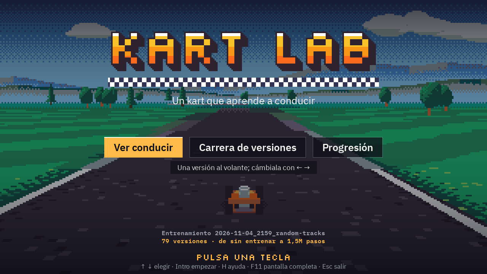
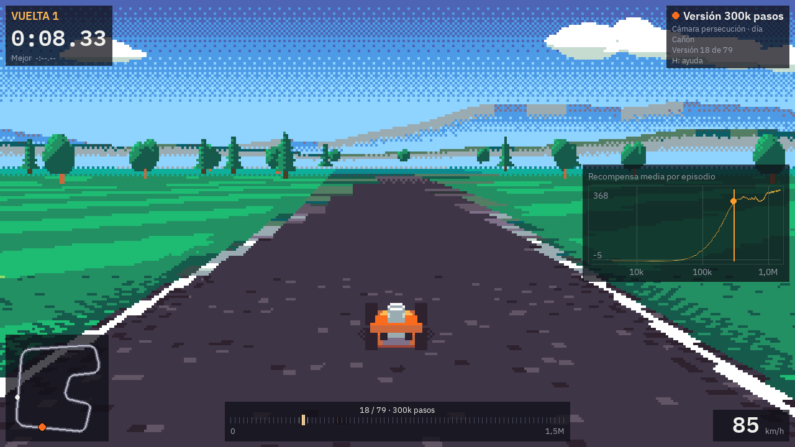

# KART LAB

Un kart que aprende a conducir solo, con aprendizaje por refuerzo (PPO), por circuitos generados proceduralmente. Un visor pseudo-3D de estilo 16 bits (suelo en perspectiva tipo «Mode 7», cámara detrás del kart y pixel art) permite ver cómo mejora, en directo y en vídeo.

## Principios

- **Simulación y visualización separadas.** La simulación es 2D (vista cenital), rápida y sin gráficos, y es lo único que usa el entrenamiento. La IA aprende de sensores numéricos (rayos de distancia, velocidad…), nunca de píxeles. El render pseudo-3D es una capa aparte que solo lee el estado de la simulación.
- **Todo en CPU.** Nada de CUDA, OpenGL ni shaders. PyTorch se instala en su versión solo CPU. Pensado para un portátil modesto sin tarjeta gráfica.
- **Todo original.** Gráficos generados por código o con licencia CC0 y fuentes con licencia OFL. La procedencia de cada recurso está en [docs/assets.md](docs/assets.md).

## Requisitos

- Windows o Linux (la CI prueba los dos).
- [uv](https://docs.astral.sh/uv/). Si no tienes Python 3.12 o 3.13, uv lo descarga.
- No hace falta tarjeta gráfica.

## Instalación

```sh
git clone https://github.com/jupiutrera/kartlab.git
cd kartlab
uv sync
uv run pre-commit install
```

## Conducir a mano

```sh
uv run python scripts/drive.py                    # circuito escaparate «Puerto», vista 3D
uv run python scripts/drive.py --track canyon     # harbor, canyon, plateau, eval:1-20 o una semilla
uv run python scripts/drive.py --variant night    # day, sunset o night
uv run python scripts/drive.py --help             # todas las opciones
```


| Tecla | Acción |
| --- | --- |
| Flechas o WASD | Girar, acelerar y frenar (con el kart parado, marcha atrás) |
| R | Volver a la línea de salida |
| 1, 2, 3 | Circuitos escaparate: Puerto, Cañón y Meseta |
| E | Siguiente circuito de evaluación |
| N | Circuito aleatorio nuevo |
| C | Cámara: persecución, retransmisión o cenital |
| V | Día, atardecer o noche |
| G | Mostrar los sensores (rayos) sobre el suelo |
| T | Vista cenital de depuración |
| Mayús (izquierda o derecha) | Barrido: mantener con el volante girado (ver abajo) |
| Tab | Piloto automático de referencia |
| P | Pausa |
| F3 | Diagnóstico: fps y milisegundos de cada parte del dibujo |
| L | Modo ligero (30 fps, suelo a media resolución vertical, menos efectos) |
| F11 | Pantalla completa |
| H | Mostrar u ocultar la ayuda |
| Esc | Salir |

### Barrido (deslizamiento)


Solo en conducción manual. Con el kart a más de 10 m/s (36 km/h), el volante girado más de un tercio y sin pisar la hierba, mantén **Mayús** para entrar en un barrido: el kart pierde agarre lateral, desliza y cierra más la curva. La dirección del barrido queda fijada al entrar; girar hacia dentro la cierra y contravolantear la abre. Se sale soltando Mayús, bajando de unos 7 m/s o tocando la hierba.

Al soltar, el kart recibe un impulso **proporcional al tiempo barrido**, con un tope (1,5 s dan el máximo, unos +6 m/s durante poco más de un segundo). Es continuo: no hay niveles ni colores por nivel. La barra de abajo muestra la carga mientras barres y se vacía mientras dura el impulso. Salir por la hierba o por falta de velocidad no da impulso.

El piloto automático y el entorno de aprendizaje no usan el barrido: no cambia las observaciones, las acciones ni la física del entrenamiento. Las constantes están en `src/kartlab/sim/drift.py` (`DriftParams`).

La ventana usa la mayor escala entera de 320×180 que cabe en la pantalla: ×4 (1280×720) en una de 1366×768 y ×5 (1600×900) en una de 1920×1080. A pantalla completa en 1080p, ×6 encaja exacto.

### Cómo se dibuja

- **El mundo** se dibuja a 320×180 con la paleta Resurrect 64 y se escala por un factor entero, sin suavizado. Texto, paneles y minimapa van encima, a la resolución de la ventana.
- **El suelo** está en perspectiva, calculado por filas con numpy.
  - La textura sale del circuito: asfalto, pianos, hierba segada y meta a cuadros.
  - Tiene la iluminación y las sombras pintadas al generarla, y mipmaps.
  - Lleva niebla tramada hacia el horizonte.
- **El cielo** tiene degradado tramado, y montañas, colinas y nubes en parallax.
- **Los karts** son modelos de vóxeles dibujados por código con *sprite stacking* en 32 ángulos y al tamaño exacto en que se ven. El decorado también se dibuja por código.
- **Efectos:** sombras, polvo, humo, marcas de derrape que se quedan y halos de los fantasmas.
- **Día, atardecer y noche** son reasignaciones de la misma paleta, sin coste por fotograma.

Para medir el tiempo de cada parte en tu equipo:

```sh
uv run python scripts/benchmark_render.py
```

Para ver de un vistazo cómo salen los circuitos generados:

```sh
uv run python scripts/track_gallery.py --showcase --count 8 --out galeria.png
```

## Entorno de aprendizaje por refuerzo

`KartEnv` ([src/kartlab/env/kart_env.py](src/kartlab/env/kart_env.py)) es un entorno Gymnasium registrado como `kartlab/Kart-v0`:

- **Observación**: 11 rayos de distancia a los bordes de la pista en un abanico frontal de 180°, velocidad, ángulo respecto a la dirección de la pista (seno y coseno), acción anterior, posición real del volante y velocidad lateral (derrape).
- **Acción**: dirección y acelerador/freno, continuos en [-1, 1]. El agente decide cada 4 pasos de física (unos 15 Hz).
- **Recompensa**: avance neto a lo largo de la línea central (negativo hacia atrás), bonus por vuelta, penalización pequeña por volantazos y penalización con fin de episodio al salirse. La velocidad no se premia por sí misma.
- **Fin de episodio**: al salirse, si no progresa en 4 s y por límite de tiempo.
- **Circuitos**: uno aleatorio nuevo y una salida aleatoria en cada episodio, o un circuito fijo (`track="harbor"`). Los de evaluación nunca salen al entrenar.

Todos los parámetros están en `EnvConfig`.

```python
from kartlab.env.kart_env import KartEnv

env = KartEnv(track="harbor", terminate_off_track=False)
obs, info = env.reset(seed=0)
```

Para medir los pasos por segundo (un entorno, y `DummyVecEnv` frente a `SubprocVecEnv` con 1, 4, 6 y 8):

```sh
uv run python scripts/benchmark_env.py
```

## Entrenar

Con `configs/random_tracks.yaml` (1,5M pasos, unos 20 minutos en un portátil con un i5-1135G7 y sin tarjeta gráfica), el agente completa 3 vueltas sin salirse en los 20 circuitos de evaluación, que nunca ve durante el entrenamiento. También las completa en los tres circuitos escaparate. Los detalles están en [docs/experimentos.md](docs/experimentos.md).

```sh
uv run python scripts/train.py configs/fixed_track.yaml      # un circuito fijo sencillo
uv run python scripts/train.py configs/random_tracks.yaml    # circuitos aleatorios (generalizar)
uv run python scripts/live.py                                # visor del último run, en otra terminal
uv run python scripts/evaluate.py --tracks 20                # 3 vueltas en los 20 circuitos reservados
uv run tensorboard --logdir runs
```

Cada entrenamiento crea `runs/<fecha>_<hora>_<nombre>/` con:
- la configuración y el commit;
- los checkpoints, que llevan los pasos en el nombre y van con sus estadísticas de VecNormalize;
- las métricas en `metrics.csv` y TensorBoard;
- las evaluaciones en `eval.csv` y el mejor modelo en `best_model.zip`.

El entrenamiento va con prioridad baja (también sus subprocesos), así que el visor puede quedarse abierto al lado:
- muestra la última versión conduciendo en un circuito reservado, o en el del entrenamiento si es fijo;
- deja las versiones anteriores como fantasmas;
- dibuja la curva de recompensa;
- usa la vista 3D con cámara de retransmisión, y la T cambia a la vista cenital.

Cerrar el visor no afecta al entrenamiento.

`configs/demo_live.yaml` es la configuración para enseñar en directo cómo aprende desde cero. Los resultados de cada entrenamiento se anotan en [docs/experimentos.md](docs/experimentos.md).

Para elegir el tipo de VecEnv, el número de entornos y los hilos de PyTorch más rápidos en tu equipo:

```sh
uv run python scripts/benchmark_train.py
```

## Visor de exhibición

Para enseñar un entrenamiento terminado (o en curso) sin tocar nada más que el teclado: una pantalla de título con el kart conduciendo detrás y tres modos. Es un proceso aparte, solo CPU, y va a 60 fps.

```sh
uv run python scripts/viewer.py                                   # el último run con checkpoints
uv run python scripts/viewer.py --run runs/2026-11-04_2159_random-tracks --fullscreen
uv run python scripts/viewer.py --mode race --track canyon        # sin título, directo a la carrera
uv run python scripts/viewer.py --mode watch --version 300000     # empieza en la versión de 300k pasos
uv run python scripts/viewer.py --track-file tracks/ejemplo.json  # un circuito propio
uv run python scripts/viewer.py --help
```



El título muestra el mejor modelo conduciendo, con la luz cambiando despacio de día a noche. Se elige el modo con ↑ ↓ y cualquier otra tecla (o un clic) lo empieza.

| Modo | Qué enseña |
| --- | --- |
| Ver conducir | Una versión al volante, con la curva de recompensa y una barra con todas las versiones del run. Se cambia con ← →. |
| Carrera de versiones | Hasta ocho versiones a la vez desde la misma parrilla (la peor en la pole), con cuenta atrás, clasificación y minimapa. Al acabar, otra carrera empieza sola. |
| Progresión | De «sin entrenar» a la última versión, una detrás de otra en escala logarítmica de pasos, con contador, curva y cinta de versiones. Al llegar al final vuelve a empezar. |



| Tecla | Acción |
| --- | --- |
| M | Cambiar de modo (ver, carrera, progresión) |
| Esc | Volver al título; en el título, salir |
| ← → | Versión anterior o siguiente (en la carrera, a quién sigue la cámara; en la progresión, salta de versión) |
| Re Pág, Av Pág | Diez versiones atrás o adelante |
| Inicio, Fin | La primera o la última versión |
| Rueda del ratón, clic en la barra | Lo mismo con el ratón |
| 1, 2, 3 | Circuitos escaparate: Puerto, Cañón y Meseta |
| E | Siguiente circuito de evaluación |
| N | Circuito aleatorio |
| R | Reiniciar (la vuelta o la carrera) |
| C | Cámara: persecución, retransmisión o cenital |
| V | Día, atardecer o noche |
| G | Mostrar los sensores (rayos) |
| L | Modo ligero (30 fps) |
| P o Espacio | Pausa |
| S | Cámara lenta: 0,5× y 0,25× |
| F3 | Diagnóstico: fps y milisegundos de cada parte, incluida la simulación con la IA |
| F11 | Pantalla completa |
| H | Ayuda con todas las teclas |

Las teclas son las mismas que en `drive.py` donde significan lo mismo; aquí no se conduce, así que las flechas y la S quedan libres. Cada modo elige su cámara hasta que se pulsa C: persecución en el título y con versiones ya entrenadas, retransmisión en la carrera, la progresión y las versiones torpes (marean menos).

- **Sin tirones.** Los checkpoints se cargan en un hilo aparte y se guardan en caché (el primero tarda unos segundos porque hay que importar PyTorch, con el título ya en pantalla). Mientras tanto, la ventana sigue dibujando y avisa con «Cargando…». Cambiar de circuito tarda un segundo y medio la primera vez y es instantáneo al volver a uno ya visto.
- **Checkpoints que faltan.** Se muestran los que haya: los huecos no estorban, un fichero que no se puede leer se salta con un aviso, y si no hay `best_model.zip` el título usa la última versión. Si el entrenamiento sigue en marcha, la curva se actualiza y, en «Ver conducir», las versiones nuevas entran solas en la barra.
- **Sin ventana.** `SDL_VIDEODRIVER=dummy uv run python scripts/viewer.py --mode race --frames 600 --screenshot carrera.png` avanza un paso de física por fotograma y guarda el último.

## Vídeos

Los vídeos se renderizan fuera de tiempo real y van directos a ffmpeg (sin fotogramas sueltos en disco), siempre a 1920×1080 y 60 fps exactos (H.264, `yuv420p`, crf 18). El mundo de 320×180 se escala ×6 y el HUD se dibuja a 1080p. No hace falta ventana ni GPU. Cada paso de física (1/60 s) es un fotograma, con acciones deterministas, así que el mismo run y el mismo circuito dan siempre el mismo vídeo.

```sh
RUN=runs/2026-11-04_2159_random-tracks
uv run python scripts/make_video.py progression --run $RUN --track harbor --out videos/progresion.mp4
uv run python scripts/make_video.py race --run $RUN --track harbor --laps 2 --out videos/carrera.mp4
uv run python scripts/make_video.py demo --run $RUN --track eval:3 --laps 3 --out videos/demo.mp4
```

- `progression`: el mismo circuito recorrido por checkpoints en escala logarítmica de pasos (sin entrenar, 10k, 30k, 100k, 300k, 1M y el final). Cada versión rueda una vuelta o `--seconds` segundos (30 por defecto; el doble para la última). Lleva tarjeta de versión con transición suave, contador de pasos, curva de recompensa con un marcador y la cinta de versiones. Las malas siguen rodando por la hierba y se reinician al atascarse 3 s; tras el segundo reinicio se pasa a la siguiente versión.
- `race`: todas las versiones a la vez desde una parrilla de dos columnas, con la mejor al final, sin colisiones. Cámara de retransmisión siguiendo a la mejor, clasificación, minimapa y una etiqueta y un color por versión. Termina cuando la mejor completa `--laps` vueltas.
- `demo`: `best_model.zip` en un circuito que no vio durante el entrenamiento (`eval:3` por defecto), con cámara de persecución y un resumen de vueltas al final.


Otras opciones: `--camera broadcast|chase|top`, `--variant day|sunset|night`, `--steps 0,10000,100000` (versiones a mostrar) y `--normal-priority` (por defecto el proceso y ffmpeg van con prioridad baja). En un i5-1135G7 se renderizan unos 20-25 fotogramas por segundo de vídeo: la progresión de referencia (200 s de vídeo) tarda unos 10 minutos y pesa unos 170 MB. `videos/` está en `.gitignore`.

## Circuitos propios

Un circuito es un fichero JSON con las esquinas del trazado: `[x, y, radio]` en metros, en el orden de conducción (vale en sentido horario o antihorario). El radio es un máximo: si las esquinas vecinas no dejan sitio, el arco se reduce, como hace el generador. La línea de meta se coloca sola en la recta más larga.

```json
{
  "format": 1,
  "name": "Bahía del Faro",
  "width": 12,
  "decoration_seed": 7,
  "corners": [[0, 0, 40], [320, -10, 30], [400, 100, 25], [330, 190, 16]]
}
```

El circuito se construye por el mismo camino que el generador y no llega a la IA si no pasa el validador. Rechaza, con un mensaje que dice qué esquina o qué tramo falla:
- cruces del trazado consigo mismo;
- esquinas con radio menor de 14 m (lo que el kart puede tomar) o curvas más cerradas que eso una vez suavizadas;
- anchura fuera de 8-20 m;
- menos de 8 m de hierba entre tramos que no son vecinos;
- longitud fuera de 400-2500 m, entre 3 y 40 esquinas, esquinas a menos de 5 m una de otra.

Los campos desconocidos son un error, y `crossings` queda reservado para una versión futura del formato (pasos a nivel).

```sh
uv run python scripts/track_file.py validate tracks/ejemplo.json
uv run python scripts/track_file.py export --seed 7 --out mio.json     # punto de partida desde un circuito generado
uv run python scripts/track_file.py export --showcase harbor --out mio.json
uv run python scripts/drive.py --track-file tracks/ejemplo.json        # conducirlo a mano
uv run python scripts/evaluate.py --track-file tracks/ejemplo.json     # 3 vueltas con el último modelo
```

`evaluate.py` se niega a evaluar un fichero que no pasa la validación (código de salida distinto de cero) y no pisa el resultado oficial del run.
`tracks/ejemplo.json` es un diseño original; el detalle del formato está en `src/kartlab/sim/trackfile.py`.

## Comandos

| Qué | Comando |
| --- | --- |
| Tests | `uv run pytest` |
| Solo el smoke test | `uv run pytest -m smoke` |
| Lint | `uv run ruff check` |
| Formato | `uv run ruff format` |
| Todos los hooks de pre-commit | `uv run pre-commit run --all-files` |

## Estructura

```
src/kartlab/
  common/   utilidades compartidas (config, semillas, ficheros)
  sim/      simulación 2D: circuitos y física (solo numpy)
  env/      entorno Gymnasium
  train/    entrenamiento PPO, checkpoints y métricas
  render/   render pseudo-3D (numpy + pygame-ce)
  show/     visor de exhibición, visor en directo, vídeos y carreras de fantasmas
scripts/    puntos de entrada
tracks/     circuitos en fichero JSON
configs/    configuraciones de entrenamiento (YAML)
assets/     fuentes y paleta
docs/       procedencia de recursos y registro de experimentos
tests/
```

`sim`, `env` y `train` nunca importan `render`, `show` ni pygame; un test lo comprueba.

## Estado

| Fase | Contenido | Estado |
| --- | --- | --- |
| 0 | Esqueleto del repo | Hecha |
| 1 | Simulación 2D y control manual | Hecha |
| 2 | Entorno Gymnasium | Hecha |
| 3 | Entrenamiento | Hecha |
| 4 | Render pseudo-3D y dirección de arte | En revisión |
| 5 | Herramientas de exhibición | En revisión (vídeos y visor) |
| 6 | Editor de circuitos (opcional) | Pendiente |

## Licencia

Código bajo licencia [MIT](LICENSE). Los recursos de terceros conservan su propia licencia; ver [docs/assets.md](docs/assets.md).
