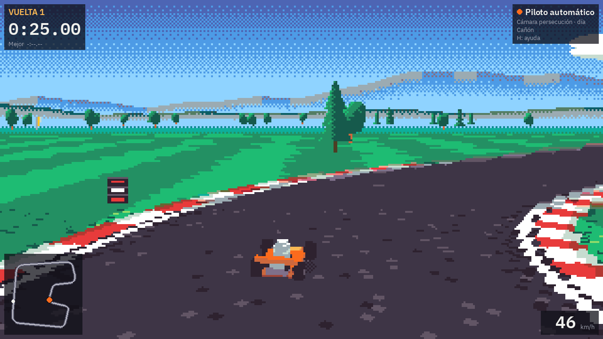
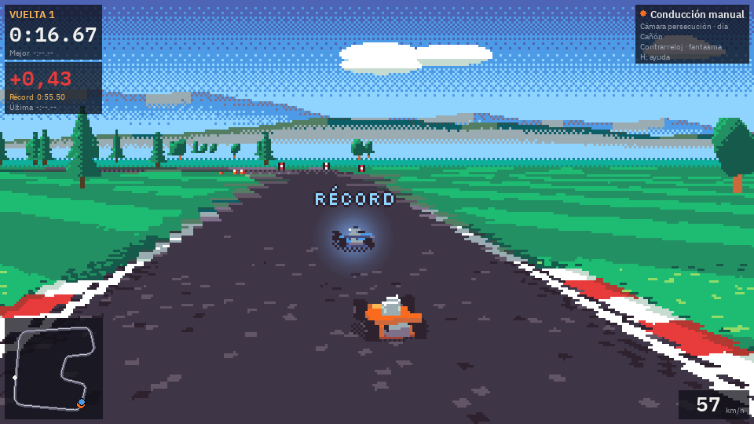
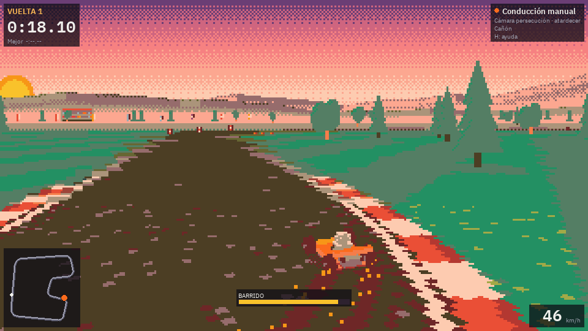
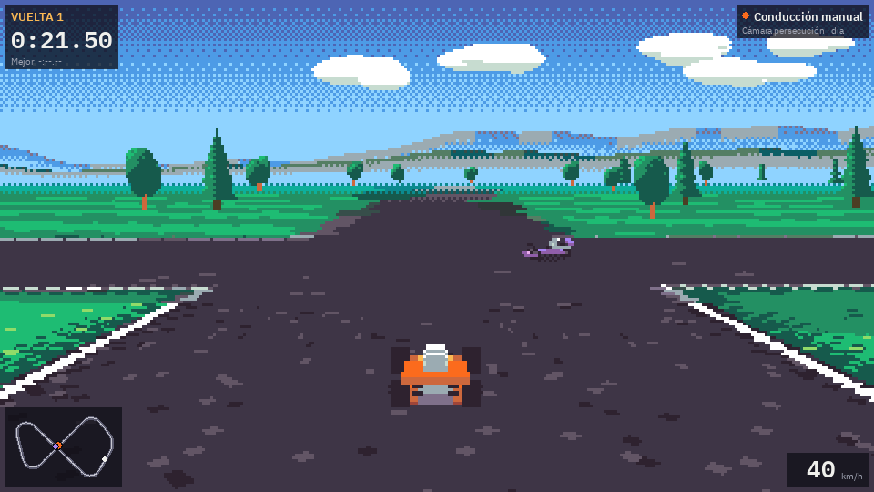

# KART LAB

Un kart que aprende a conducir solo, con aprendizaje por refuerzo (PPO), por circuitos generados proceduralmente. Un visor pseudo-3D de estilo 16 bits (suelo en perspectiva tipo «Mode 7», cámara detrás del kart y pixel art) permite ver cómo mejora, en directo y en vídeo.

## Principios

- **Simulación y visualización separadas.** La simulación es 2D (vista cenital), rápida y sin gráficos, y es lo único que usa el entrenamiento. La IA aprende de sensores numéricos (rayos de distancia, velocidad…), nunca de píxeles. El render pseudo-3D es una capa aparte que solo lee el estado de la simulación.
- **Todo en CPU.** Nada de CUDA, OpenGL ni shaders. PyTorch se instala en su versión solo CPU. Pensado para un portátil modesto sin tarjeta gráfica.
- **Todo original.** Gráficos generados por código o con licencia CC0 y fuentes con licencia OFL. La procedencia de cada recurso está en [docs/assets.md](docs/assets.md).

## Requisitos

- Windows o Linux (la CI prueba los dos).
- [uv](https://docs.astral.sh/uv/). Si no tienes Python 3.12 o 3.13, uv lo descarga.
- No hace falta tarjeta gráfica.

## Instalación

```sh
git clone https://github.com/jupiutrera/kartlab.git
cd kartlab
uv sync
uv run pre-commit install
```

## Conducir a mano

```sh
uv run python scripts/drive.py                    # circuito escaparate «Puerto», vista 3D
uv run python scripts/drive.py --track canyon     # harbor, canyon, plateau, eval:1-20 o una semilla
uv run python scripts/drive.py --variant night    # day, sunset o night
uv run python scripts/drive.py --help             # todas las opciones
```



| Tecla | Acción |
| --- | --- |
| Flechas o WASD | Girar, acelerar y frenar (con el kart parado, marcha atrás) |
| R | Volver a la línea de salida |
| 1, 2, 3 | Circuitos escaparate: Puerto, Cañón y Meseta |
| E | Siguiente circuito de evaluación |
| N | Circuito aleatorio nuevo |
| C | Cámara: persecución, retransmisión o cenital |
| V | Día, atardecer o noche |
| G | Mostrar los sensores (rayos) sobre el suelo |
| T | Vista cenital de depuración |
| Mayús (izquierda o derecha) | Barrido: mantener con el volante girado (ver abajo) |
| K | Activar o desactivar la contrarreloj (ver abajo) |
| F | Mostrar u ocultar el fantasma del récord |
| Tab | Piloto automático de referencia |
| P | Pausa |
| F3 | Diagnóstico: fps y milisegundos de cada parte del dibujo |
| L | Modo ligero (30 fps, suelo a media resolución vertical, menos efectos) |
| F11 | Pantalla completa |
| H | Mostrar u ocultar la ayuda |
| Esc | Salir |

### Contrarreloj



```sh
uv run python scripts/drive.py --time-trial                      # empieza ya en contrarreloj
uv run python scripts/drive.py --time-trial --track-file tracks/ejemplo.json
```

O pulsa **K** en cualquier momento para activarla o desactivarla. Da vueltas al circuito: la primera completa se guarda como récord y, a partir de ahí, cada vuelta más rápida lo sustituye. Los datos son solo poses (x, y, rumbo) con su tiempo, así que el barrido cuenta igual que cualquier otra forma de conducir.

- **Fantasma.** El récord se reproduce como un kart azul con halo, siguiendo el reloj de tu vuelta actual: cada vez que cruzas la meta vuelve a salir de la línea. Si llega antes que tú, espera un segundo en la meta y desaparece. **F** lo oculta o lo muestra.
- **Diferencia en vivo.** Bajo el cronómetro: `−0,42` en verde si vas por delante del récord, `+1,03` en rojo si vas por detrás. Se calcula con el tiempo que tardó el récord en llegar al mismo punto de la línea central (por progreso, no por reloj) y se suaviza para que no tiemble. Debajo, el tiempo del récord y el de tu última vuelta.
- **Qué cuenta.** Solo las vueltas completas, conducidas a mano y salidas desde la línea (con **R** o cruzando la meta). Reiniciar, cambiar de circuito, usar el piloto automático (Tab) o salir marcha atrás sin completar la vuelta nunca tocan el récord. La primera vuelta sale parada y las siguientes lanzadas, por eso la segunda suele batir a la primera.
- **Dónde se guarda.** En `records/` (ignorado por git), un JSON pequeño por circuito, con escritura atómica. `--records-dir` elige otra carpeta. Borrar el fichero borra el récord.
- **Cuándo se ignora un récord.** Si el circuito ya no es el mismo (otra forma, ancho o nombre), si cambió la física del kart (`PHYSICS_VERSION` en `src/kartlab/sim/version.py`) o si el fichero está dañado: aparece un aviso y se empieza sin récord, sin romper nada. Quien cambie la física del kart debe subir esa constante.

### Barrido (deslizamiento)



Solo en conducción manual. Con el kart a más de 10 m/s (36 km/h), el volante girado más de un tercio y sin pisar la hierba, mantén **Mayús** para entrar en un barrido: el kart pierde agarre lateral, desliza y cierra más la curva. La dirección del barrido queda fijada al entrar; girar hacia dentro la cierra y contravolantear la abre. Se sale soltando Mayús, bajando de unos 7 m/s o tocando la hierba.

Al soltar, el kart recibe un impulso **proporcional al tiempo barrido**, con un tope (1,5 s dan el máximo, unos +6 m/s durante poco más de un segundo). Es continuo: no hay niveles ni colores por nivel. La barra de abajo muestra la carga mientras barres y se vacía mientras dura el impulso. Salir por la hierba o por falta de velocidad no da impulso.

El piloto automático y el entorno de aprendizaje no usan el barrido: no cambia las observaciones, las acciones ni la física del entrenamiento. Las constantes están en `src/kartlab/sim/drift.py` (`DriftParams`).

La ventana usa la mayor escala entera de 320×180 que cabe en la pantalla: ×4 (1280×720) en una de 1366×768 y ×5 (1600×900) en una de 1920×1080. A pantalla completa en 1080p, ×6 encaja exacto.

### Cómo se dibuja

- **El mundo** se dibuja a 320×180 con la paleta Resurrect 64 y se escala por un factor entero, sin suavizado. Texto, paneles y minimapa van encima, a la resolución de la ventana.
- **El suelo** está en perspectiva, calculado por filas con numpy.
  - La textura sale del circuito: asfalto, pianos, hierba segada y meta a cuadros.
  - Tiene la iluminación y las sombras pintadas al generarla, y mipmaps.
  - Lleva niebla tramada hacia el horizonte.
- **El cielo** tiene degradado tramado, y montañas, colinas y nubes en parallax.
- **Los karts** son modelos de vóxeles dibujados por código con *sprite stacking* en 32 ángulos y al tamaño exacto en que se ven. El decorado también se dibuja por código.
- **Efectos:** sombras, polvo, humo, marcas de derrape que se quedan y halos de los fantasmas.
- **Día, atardecer y noche** son reasignaciones de la misma paleta, sin coste por fotograma.

Para medir el tiempo de cada parte en tu equipo:

```sh
uv run python scripts/benchmark_render.py
```

Para ver de un vistazo cómo salen los circuitos generados:

```sh
uv run python scripts/track_gallery.py --showcase --count 8 --out galeria.png
```

## Entorno de aprendizaje por refuerzo

`KartEnv` ([src/kartlab/env/kart_env.py](src/kartlab/env/kart_env.py)) es un entorno Gymnasium registrado como `kartlab/Kart-v0`:

- **Observación**: 11 rayos de distancia a los bordes de la pista en un abanico frontal de 180°, velocidad, ángulo respecto a la dirección de la pista (seno y coseno), acción anterior, posición real del volante y velocidad lateral (derrape).
- **Acción**: dirección y acelerador/freno, continuos en [-1, 1]. El agente decide cada 4 pasos de física (unos 15 Hz).
- **Recompensa**: avance neto a lo largo de la línea central (negativo hacia atrás), bonus por vuelta, penalización pequeña por volantazos y penalización con fin de episodio al salirse. La velocidad no se premia por sí misma.
- **Fin de episodio**: al salirse, si no progresa en 4 s y por límite de tiempo.
- **Circuitos**: uno aleatorio nuevo y una salida aleatoria en cada episodio, o un circuito fijo (`track="harbor"`). Los de evaluación nunca salen al entrenar.

Todos los parámetros están en `EnvConfig`.

```python
from kartlab.env.kart_env import KartEnv

env = KartEnv(track="harbor", terminate_off_track=False)
obs, info = env.reset(seed=0)
```

Para medir los pasos por segundo (un entorno, y `DummyVecEnv` frente a `SubprocVecEnv` con 1, 4, 6 y 8):

```sh
uv run python scripts/benchmark_env.py
```

## Entrenar

Con `configs/random_tracks.yaml` (1,5M pasos, unos 20 minutos en un portátil con un i5-1135G7 y sin tarjeta gráfica), el agente completa 3 vueltas sin salirse en los 20 circuitos de evaluación, que nunca ve durante el entrenamiento. También las completa en los tres circuitos escaparate. Los detalles están en [docs/experimentos.md](docs/experimentos.md).

```sh
uv run python scripts/train.py configs/fixed_track.yaml      # un circuito fijo sencillo
uv run python scripts/train.py configs/random_tracks.yaml    # circuitos aleatorios (generalizar)
uv run python scripts/live.py                                # visor del último run, en otra terminal
uv run python scripts/evaluate.py --tracks 20                # 3 vueltas en los 20 circuitos reservados
uv run tensorboard --logdir runs
```

Cada entrenamiento crea `runs/<fecha>_<hora>_<nombre>/` con:
- la configuración y el commit;
- los checkpoints, que llevan los pasos en el nombre y van con sus estadísticas de VecNormalize;
- las métricas en `metrics.csv` y TensorBoard;
- las evaluaciones en `eval.csv` y el mejor modelo en `best_model.zip`.

El entrenamiento va con prioridad baja (también sus subprocesos), así que el visor puede quedarse abierto al lado:
- muestra la última versión conduciendo en un circuito reservado, o en el del entrenamiento si es fijo;
- deja las versiones anteriores como fantasmas;
- dibuja la curva de recompensa;
- usa la vista 3D con cámara de retransmisión, y la T cambia a la vista cenital.

Cerrar el visor no afecta al entrenamiento.

`configs/demo_live.yaml` es la configuración para enseñar en directo cómo aprende desde cero. Los resultados de cada entrenamiento se anotan en [docs/experimentos.md](docs/experimentos.md).

Para elegir el tipo de VecEnv, el número de entornos y los hilos de PyTorch más rápidos en tu equipo:

```sh
uv run python scripts/benchmark_train.py
```

## Circuitos propios

Un circuito es un fichero JSON con las esquinas del trazado: `[x, y, radio]` en metros, en el orden de conducción (vale en sentido horario o antihorario). El radio es un máximo: si las esquinas vecinas no dejan sitio, el arco se reduce, como hace el generador. La línea de meta se coloca sola en la recta más larga.

```json
{
  "format": 1,
  "name": "Bahía del Faro",
  "width": 12,
  "decoration_seed": 7,
  "corners": [[0, 0, 40], [320, -10, 30], [400, 100, 25], [330, 190, 16]]
}
```

El circuito se construye por el mismo camino que el generador y no llega a la IA si no pasa el validador. Rechaza, con un mensaje que dice qué esquina o qué tramo falla:
- cruces del trazado consigo mismo, salvo los cruces a nivel declarados (ver «El circuito en 8»);
- esquinas con radio menor de 14 m (lo que el kart puede tomar) o curvas más cerradas que eso una vez suavizadas;
- anchura fuera de 8-20 m;
- menos de 8 m de hierba entre tramos que no son vecinos;
- longitud fuera de 400-2500 m, entre 3 y 40 esquinas, esquinas a menos de 5 m una de otra.

Los campos desconocidos son un error. El campo `crossings` solo existe en el formato 2 (ver abajo); un fichero de formato 1 que lo traiga se rechaza.

```sh
uv run python scripts/track_file.py validate tracks/ejemplo.json
uv run python scripts/track_file.py export --seed 7 --out mio.json     # punto de partida desde un circuito generado
uv run python scripts/track_file.py export --showcase harbor --out mio.json
uv run python scripts/drive.py --track-file tracks/ejemplo.json        # conducirlo a mano
uv run python scripts/evaluate.py --track-file tracks/ejemplo.json     # 3 vueltas con el último modelo
```

`evaluate.py` se niega a evaluar un fichero que no pasa la validación (código de salida distinto de cero) y no pisa el resultado oficial del run.
`tracks/ejemplo.json` es un diseño original; el detalle del formato está en `src/kartlab/sim/trackfile.py`.

### El circuito en 8 (cruce a nivel)



`tracks/ocho.json` («Lazo del Molino», 1.277 m, 13 m de ancho) es un 8 con **cruce a nivel**: las dos carreteras se cortan a 90° sobre el mismo plano, sin puente ni túnel. Es un circuito de exhibición: no se usa para entrenar ni para la evaluación oficial.

```sh
uv run python scripts/drive.py --track-file tracks/ocho.json                     # a mano, vista 3D
uv run python scripts/drive.py --track-file tracks/ocho.json --view topdown      # cenital
uv run python scripts/drive.py --track-file tracks/ocho.json --camera broadcast  # cámara de retransmisión
uv run python scripts/evaluate.py --track-file tracks/ocho.json --laps 3         # modelo de referencia
```

Un circuito con cruces usa el **formato 2**: el de siempre más `"crossings": [[x, y], ...]` con los puntos aproximados donde la línea central se cruza consigo misma (el formato 2 exige al menos un cruce; sin cruces el fichero sigue siendo de formato 1). El validador solo acepta un autocruce donde esté declarado (a menos de 12 m) y si es una X limpia: ángulo de al menos 60°, los dos tramos rectos en 34 m alrededor, lejos de la meta y sin otras partes del circuito demasiado cerca. El formato 2 admite además `"start": [x, y]` (la salida, a menos de 3 m de la línea central y en recta): sin él la meta se coloca en la recta más larga lejos del cruce, pero un empate entre rectas casi iguales puede resolverse distinto en otra plataforma, así que un fichero compartido debe declararla.

Cómo se trata el cruce:
- **Rama.** Cada punto del kart pertenece a una de las dos carreteras (la que sigue desde el paso anterior), de modo que el progreso, la cámara y los sensores no saltan de una a otra al cruzar. Si el kart gira dentro del cruce y sale por la otra carretera, pasa a esa rama y ese salto nunca suma progreso (ver «Vueltas»). Atravesar el cruce de frente no cambia de rama.
- **Hierba.** En el cruce, la otra carretera también es asfalto. Con cruces, `Racer.on_grass` pregunta a todo el circuito; sin cruces es el cálculo de siempre.
- **Vueltas y progreso.** Girar en el cruce para repetir un solo lazo ni cuenta vueltas ni suma progreso: el salto de un punto del circuito a otro (por ejemplo, del final del lazo al principio) se carga al progreso neto como el camino de vuelta por la línea central, nunca como crédito, así que un lazo completo suma cero, en el entorno también (recompensa por progreso incluida). Saltarse un lazo hacia delante tampoco da crédito por lo saltado. Es el precio de girar en el cruce: el progreso baja de golpe y el entorno acaba terminando el episodio por falta de avance. Como segunda guarda, una vuelta solo cuenta si además se ha avanzado por todas las décimas del circuito. Una vuelta normal no cambia.
- **Salida y reinicios.** La línea de meta queda fuera de la zona del cruce. Si un reinicio cae justo en el cruce, la rama es la de `start_s`; sin hint (por ejemplo, `locate(x, y)` suelto) gana la muestra más cercana, y en un empate exacto la de menor índice.
- **Sensores.** Los rayos ven solo los bordes de la propia rama, así que dentro del cruce detectan «paredes» que en realidad son la otra carretera. Es un límite conocido; ver `docs/experimentos.md`.

## Comandos

| Qué | Comando |
| --- | --- |
| Tests | `uv run pytest` |
| Solo el smoke test | `uv run pytest -m smoke` |
| Lint | `uv run ruff check` |
| Formato | `uv run ruff format` |
| Todos los hooks de pre-commit | `uv run pre-commit run --all-files` |

## Estructura

```
src/kartlab/
  common/   utilidades compartidas (config, semillas, ficheros)
  sim/      simulación 2D: circuitos y física (solo numpy)
  env/      entorno Gymnasium
  train/    entrenamiento PPO, checkpoints y métricas
  render/   render pseudo-3D (numpy + pygame-ce)
  show/     visor, vídeos y carreras de fantasmas
scripts/    puntos de entrada
tracks/     circuitos en fichero JSON
configs/    configuraciones de entrenamiento (YAML)
assets/     fuentes y paleta
docs/       procedencia de recursos y registro de experimentos
tests/
```

`sim`, `env` y `train` nunca importan `render`, `show` ni pygame; un test lo comprueba.

## Estado

| Fase | Contenido | Estado |
| --- | --- | --- |
| 0 | Esqueleto del repo | Hecha |
| 1 | Simulación 2D y control manual | Hecha |
| 2 | Entorno Gymnasium | Hecha |
| 3 | Entrenamiento | Hecha |
| 4 | Render pseudo-3D y dirección de arte | En revisión |
| 5 | Herramientas de exhibición | Pendiente |
| 6 | Editor de circuitos (opcional) | Pendiente |

## Licencia

Código bajo licencia [MIT](LICENSE). Los recursos de terceros conservan su propia licencia; ver [docs/assets.md](docs/assets.md).
